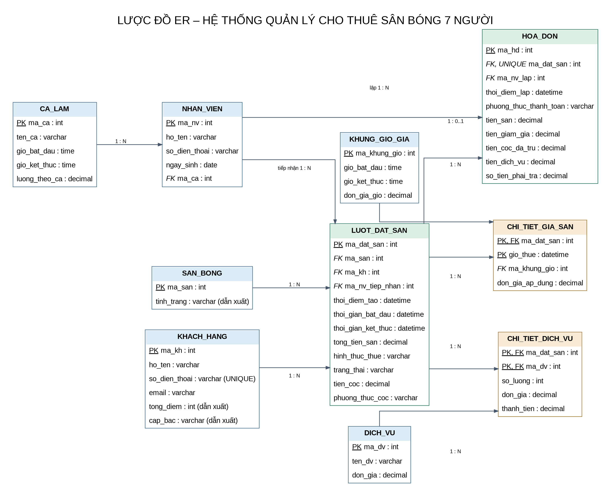

# ⚽ FootballField — Football Pitch Management System

A web-based football pitch rental management system developed as a Database Systems course project at **Posts and Telecommunications Institute of Technology (PTIT)**.

FootballField helps manage daily football pitch operations, including bookings, customers, pricing, additional services, invoices, payments, and business statistics.

<p align="center">

  
  
  
  
  

</p>

---

## 📌 Table of Contents

- [Overview](#-overview)
- [Features](#-features)
- [Tech Stack](#-tech-stack)
- [Database Design](#-database-design)
- [Project Structure](#-project-structure)
- [Installation](#-installation)
- [Demo Account](#-demo-account)
- [Business Workflow](#-business-workflow)
- [Deployment](#-deployment)
- [Documentation](#-documentation)

## 🎯 Overview

FootballField is designed to simplify the management of a football pitch rental business.

The system provides an integrated workflow for staff to manage customers, schedule bookings, calculate rental fees, handle additional services, generate invoices, and monitor business performance.

The project focuses on applying relational database design and SQL operations to a practical management application.

## ✨ Features

### 📊 Dashboard
- Overview of football pitches, customers, bookings, and revenue.
- Quick access to important management functions.

### 👥 Customer Management
- Create and manage customer profiles.
- Search customers by phone number.
- Track loyalty points and membership tiers.
- Automatically update customer points after successful payment.

### ⚽ Pitch & Booking Management
- Manage football pitches and booking schedules.
- Create and cancel bookings.
- Validate overlapping booking times.
- Calculate rental fees based on hourly pricing.
- Support deposits and booking status management.

### 💰 Pricing Management
- Configure different hourly prices for different time ranges.
- Calculate booking costs based on the selected time slots.

### 🥤 Additional Services
- Add services such as ball rental, bib rental, and drinks to active bookings.
- Track service quantities and costs.

### 🧾 Invoice & Payment Management
- Generate invoices for completed bookings.
- Calculate pitch rental fees, discounts, deposits, and service charges.
- Support cash and demo bank-transfer payment interfaces.

### 📈 Statistics & Reports
- View revenue statistics.
- Analyze booking activity.
- Identify frequently booked pitches and valuable customers.

## 🧰 Tech Stack

| Technology | Purpose |
|---|---|
| PHP 8+ | Backend logic and server-side processing |
| MySQL 8+ / MariaDB | Relational database |
| HTML5 | Page structure |
| CSS3 | Interface styling |
| JavaScript | Client-side interactions |
| PDO | PHP database connectivity |
| XAMPP | Local development environment |
| Git & GitHub | Version control |

## 🗄️ Database Design

The application uses a relational MySQL database to manage the main entities and their relationships.

The database includes tables for:

- Employees and work shifts
- Customers
- Football pitches
- Hourly pricing
- Bookings
- Booking price details
- Services
- Booking service details
- Invoices

### Entity Relationship Diagram



Database files:

- `database/footballfield.sql` — database schema and sample data.
- `database/queries.sql` — SQL queries for reporting and statistics.

## 📁 Project Structure

```text
FootballField/
│
├── assets/
│   ├── app.js
│   ├── style.css
│   └── demo-qr.png
│
├── database/
│   ├── footballfield.sql
│   └── queries.sql
│
├── config.php
├── index.php
├── login.php
├── views.php
│
├── ERD_FootballField.png
├── DEMO_SCRIPT.md
└── README.md
```

## ⚙️ Installation

### Requirements

- PHP 8+
- MySQL 8+ or MariaDB
- XAMPP (recommended)
- Web browser

### Step 1 — Clone the repository

```bash
git clone https://github.com/icyr4zo/FootballField.git
```

### Step 2 — Set up XAMPP

Move the project folder into:

```text
C:\xampp\htdocs\FootballField
```

Start **Apache** and **MySQL** from XAMPP Control Panel.

### Step 3 — Import the database

1. Open [phpMyAdmin](http://localhost/phpmyadmin).
2. Import `database/footballfield.sql`.
3. Make sure the database is named `footballfield`.

### Step 4 — Configure database connection

Open `config.php` and check:

```php
const DB_HOST = '127.0.0.1';
const DB_NAME = 'footballfield';
const DB_USER = 'root';
const DB_PASS = '';
```

Update the credentials if your MySQL configuration is different.

### Step 5 — Run the application

Open:

```text
http://localhost/FootballField/
```

## 🔐 Demo Account

The project includes a shared administrator account for demonstration purposes.

- **Username:** `admin`
- **Password:** `Football@2026`

The password is verified using PHP's `password_verify()`.

Do not reuse the demo credentials in a public production environment.

## 🔄 Business Workflow

1. View business information on the dashboard.
2. Manage customer profiles.
3. Configure football pitches and hourly prices.
4. Create a booking and calculate the rental fee.
5. Receive customers when they arrive.
6. Add additional services to an active booking.
7. Generate an invoice and calculate the final amount.
8. Confirm payment and update customer loyalty points.
9. Review business statistics.

## 🚀 Deployment

FootballField is a **PHP + MySQL application**, so it cannot be deployed directly using GitHub Pages.

To deploy it online, you need a hosting provider that supports:

- PHP 8+
- MySQL or MariaDB
- PHP extensions such as `pdo_mysql`
- HTTPS and server-side configuration

The current repository is configured for local XAMPP development. Before public deployment, database credentials should be moved out of public source code, and additional security measures such as individual user accounts, authorization, CSRF protection, and session hardening should be implemented.

The bank-transfer QR feature is a visual demonstration only, not a real payment integration.

## 📚 Documentation

- [Demo Presentation Script](DEMO_SCRIPT.md)
- [Entity Relationship Diagram](ERD_FootballField.png)

---

## 👨‍💻 Author

**icyr4zo**

IT Student | PTIT

[GitHub Profile](https://github.com/icyr4zo)

<p align="center">
  <i>Built to apply database design and web development concepts to a practical management system.</i>
</p>
